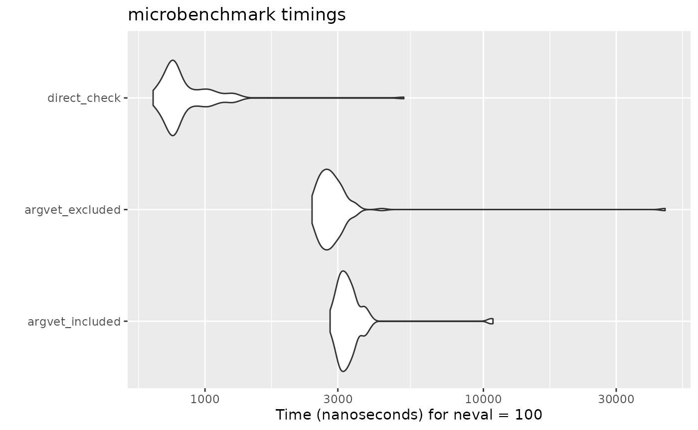
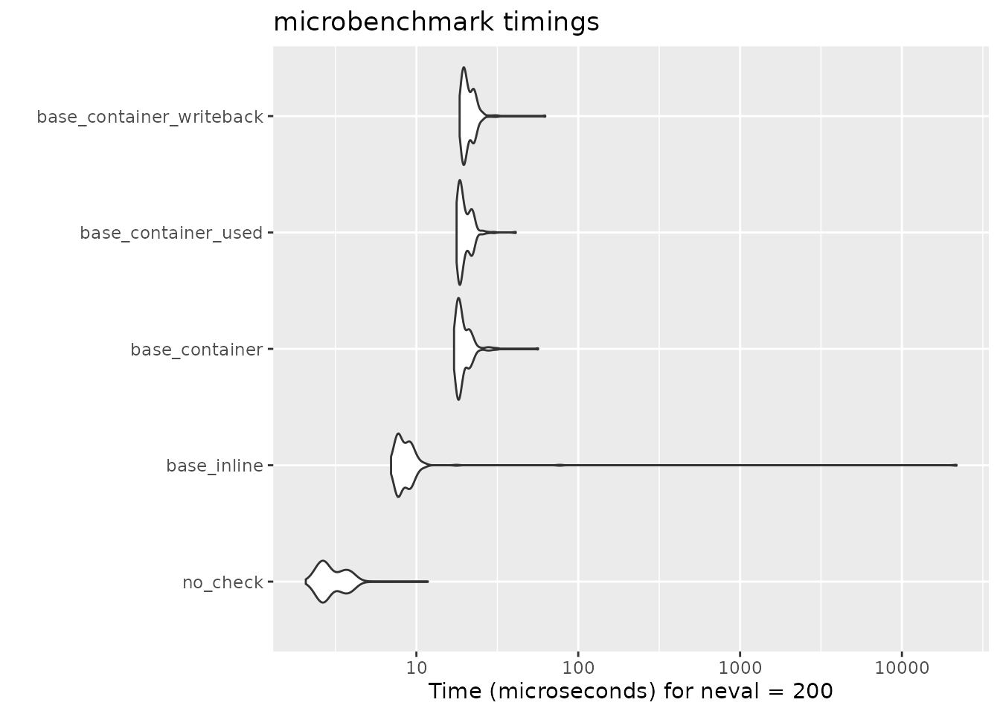
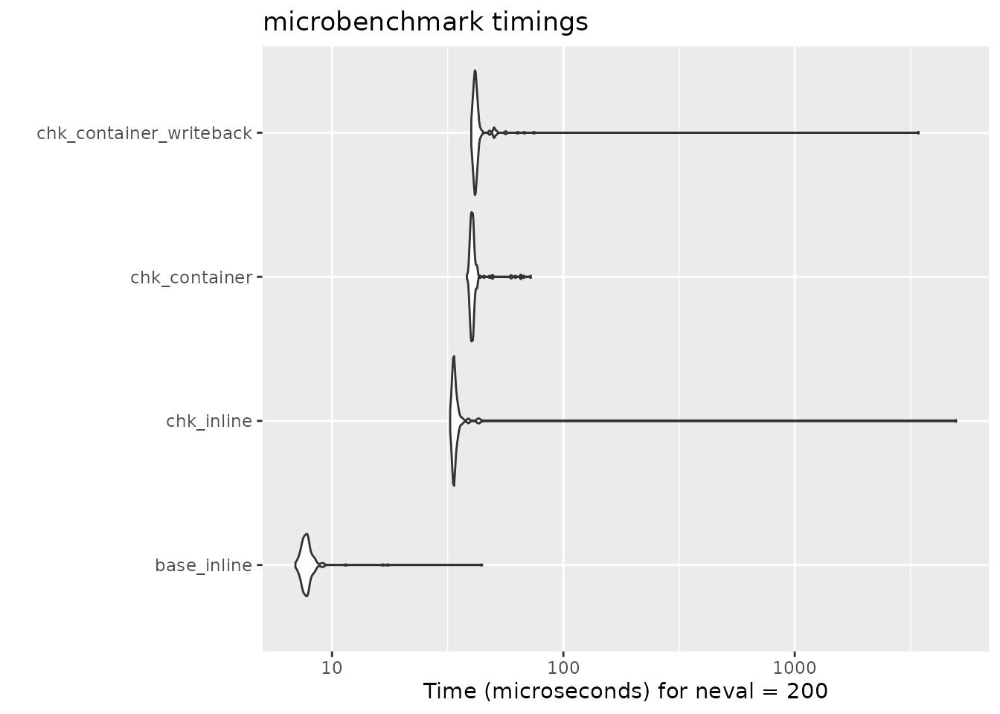
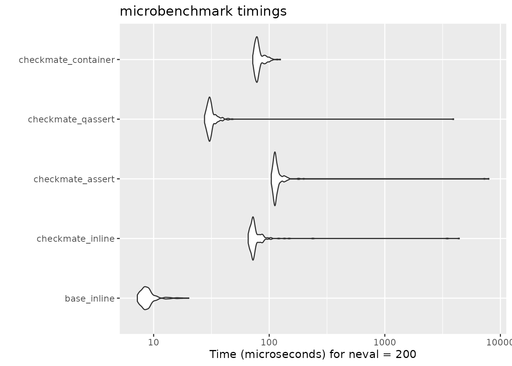
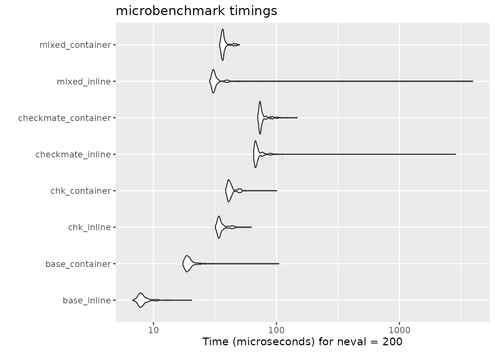

# Performance Benchmark

``` r

library(argvet)
library(microbenchmark)
```

## Performance cost in argument passing:

``` r

check_fn <- make_arg_validator({
  if (!is.integer(x)) {
    stop("x must be integer")
  }
  if (!is.integer(y)) {
    stop("y must be integer")
  }
})

stats <- microbenchmark(
  argvet_included = {
    check_fn_inner <- make_arg_validator({
      if (!is.integer(x)) {
        stop("x must be integer")
      }
      if (!is.integer(y)) {
        stop("y must be integer")
      }
    })

    f <- function(x, y) {
      check_fn_inner()
      x + y
    }

    f(1L, 2L)
  },
  argvet_excluded = {
    f <- function(x, y) {
      check_fn()
      x + y
    }

    f(1L, 2L)
  },
  direct_check = {
    f <- function(x, y) {
      if (!is.integer(x)) {
        stop("x must be integer")
      }
      if (!is.integer(y)) {
        stop("y must be integer")
      }
      x + y
    }

    f(1L, 2L)
  }
)
print(stats)
#> Unit: nanoseconds
#>             expr  min     lq    mean median     uq   max neval
#>  argvet_included 2814 3060.0 3398.67   3210 3405.5 10826   100
#>  argvet_excluded 2424 2628.5 3265.76   2794 3034.5 44957   100
#>     direct_check  651  751.0  885.55    781  916.5  5178   100
```

``` r

ggplot2::autoplot(stats)
#> Warning: `aes_string()` was deprecated in ggplot2 3.0.0.
#> ℹ Please use tidy evaluation idioms with `aes()`.
#> ℹ See also `vignette("ggplot2-in-packages")` for more information.
#> ℹ The deprecated feature was likely used in the microbenchmark package.
#>   Please report the issue at
#>   <https://github.com/joshuaulrich/microbenchmark/issues/>.
#> This warning is displayed once per session.
#> Call `lifecycle::last_lifecycle_warnings()` to see where this warning was
#> generated.
```



The cost of creating validator container can be negligible.

## Performance cost in heavy validation:

``` r

heavy_args <- list(
  name = "model_01",
  threads = 4L,
  seed = 42L,
  arg_1 = 1,
  arg_2 = 2,
  arg_3 = 3,
  arg_4 = 4,
  arg_5 = 5,
  lower = 0,
  upper = 10,
  tolerance = 0.5,
  verbose = TRUE
)

# Every candidate has exactly these 12 formals; only the body changes.
make_fit <- function(expr) {
  f <- function(
    name,
    threads,
    seed,
    arg_1,
    arg_2,
    arg_3,
    arg_4,
    arg_5,
    lower,
    upper,
    tolerance,
    verbose
  ) {
    NULL
  }
  body(f) <- expr
  f
}

# Compile one block of rules twice: into an argvet container, and into the
# body of a plain function. This keeps both arms perfectly comparable.
compile_rules <- function(rules) {
  block <- substitute(rules)
  validator <- eval(call("make_arg_validator", block))
  inline <- make_fit(as.call(c(
    list(as.name("{")),
    as.list(block)[-1L],
    list(quote(arg_1 + arg_2))
  )))
  list(validator = validator, inline = inline)
}

median_us <- function(mb) {
  s <- summary(mb)
  stats::setNames(s$median, as.character(s$expr))
}

bm_times <- 200L
```

The rule blocks. `base` uses hand-written tests, `chk` uses only `chk`,
`checkmate` uses only `checkmate` (in three different idioms), and
`mixed` combines the last two as shown in the README. All of them pass
for `heavy_args`, so no error path is being timed.

``` r

base_rules <- compile_rules({
  if (!is.character(name) || length(name) != 1L || is.na(name)) {
    stop("name")
  }
  if (!nzchar(name)) {
    stop("name")
  }
  if (!is.integer(threads) || length(threads) != 1L || is.na(threads)) {
    stop("threads")
  }
  if (threads < 1L || threads > 64L) {
    stop("threads")
  }
  if (!is.integer(seed) || length(seed) != 1L || is.na(seed)) {
    stop("seed")
  }
  if (seed < 0L) {
    stop("seed")
  }
  for (v in list(arg_1, arg_2, arg_3, arg_4, arg_5)) {
    if (!is.numeric(v) || length(v) != 1L || is.na(v)) {
      stop("arg")
    }
    if (v < lower || v > upper) stop("arg")
  }
  if (!is.numeric(lower) || length(lower) != 1L || is.na(lower)) {
    stop("lower")
  }
  if (!is.numeric(upper) || length(upper) != 1L || is.na(upper)) {
    stop("upper")
  }
  if (lower >= upper) {
    stop("lower/upper")
  }
  if (!is.numeric(tolerance) || length(tolerance) != 1L || is.na(tolerance)) {
    stop("tolerance")
  }
  if (tolerance <= 0) {
    stop("tolerance")
  }
  if (!is.logical(verbose) || length(verbose) != 1L || is.na(verbose)) {
    stop("verbose")
  }
  if (arg_1 + arg_2 + arg_3 + arg_4 + arg_5 > 10 * upper) stop("sum")
})

chk_rules <- compile_rules({
  chk::chk_string(name)
  chk::chk_integer(threads)
  chk::chk_gte(threads, 1L)
  chk::chk_lte(threads, 64L)
  chk::chk_whole_number(seed)
  chk::chk_gte(seed, 0L)
  for (v in list(arg_1, arg_2, arg_3, arg_4, arg_5)) {
    chk::chk_number(v)
    chk::chk_gte(v, lower)
    chk::chk_lte(v, upper)
  }
  chk::chk_number(lower)
  chk::chk_number(upper)
  chk::chk_number(tolerance)
  chk::chk_gt(tolerance, 0)
  chk::chk_flag(verbose)
})

cm_rules <- compile_rules({
  checkmate::assertString(name)
  checkmate::assertInt(threads)
  checkmate::assertInt(threads, lower = 1L)
  checkmate::assertInt(threads, upper = 64L)
  checkmate::assertCount(seed)
  for (v in list(arg_1, arg_2, arg_3, arg_4, arg_5)) {
    checkmate::assertNumber(v)
    checkmate::assertNumber(v, lower = lower)
    checkmate::assertNumber(v, upper = upper)
  }
  checkmate::assertNumber(lower)
  checkmate::assertNumber(upper)
  checkmate::assertNumber(tolerance)
  checkmate::assertNumber(tolerance, lower = 0)
  checkmate::assertFlag(verbose)
})

cm_assert_rules <- compile_rules({
  checkmate::assert(
    checkmate::checkString(name),
    checkmate::checkInt(threads),
    checkmate::checkInt(threads, lower = 1L),
    checkmate::checkInt(threads, upper = 64L),
    checkmate::checkCount(seed),
    checkmate::checkNumber(arg_1),
    checkmate::checkNumber(arg_1, lower = lower),
    checkmate::checkNumber(arg_1, upper = upper),
    checkmate::checkNumber(arg_2),
    checkmate::checkNumber(arg_2, lower = lower),
    checkmate::checkNumber(arg_2, upper = upper),
    checkmate::checkNumber(arg_3),
    checkmate::checkNumber(arg_3, lower = lower),
    checkmate::checkNumber(arg_3, upper = upper),
    checkmate::checkNumber(arg_4),
    checkmate::checkNumber(arg_4, lower = lower),
    checkmate::checkNumber(arg_4, upper = upper),
    checkmate::checkNumber(arg_5),
    checkmate::checkNumber(arg_5, lower = lower),
    checkmate::checkNumber(arg_5, upper = upper),
    checkmate::checkNumber(lower),
    checkmate::checkNumber(upper),
    checkmate::checkNumber(tolerance),
    checkmate::checkNumber(tolerance, lower = 0),
    checkmate::checkFlag(verbose),
    combine = "and"
  )
})

cm_qassert_rules <- compile_rules({
  checkmate::qassert(name, "s1")
  checkmate::qassert(threads, "i1")
  checkmate::qassert(threads, "i1[1,64]")
  checkmate::qassert(seed, "i1[0,Inf]")
  for (v in list(arg_1, arg_2, arg_3, arg_4, arg_5)) {
    checkmate::qassert(v, "n1")
    checkmate::qassert(v, "n1[0,10]")
  }
  checkmate::qassert(lower, "n1")
  checkmate::qassert(upper, "n1")
  checkmate::qassert(tolerance, "n1")
  checkmate::qassert(tolerance, "n1(0,Inf]")
  checkmate::qassert(verbose, "b1")
})

mixed_rules <- compile_rules({
  chk::chk_string(name)
  chk::chk_integer(threads)
  checkmate::assertCount(seed)
  for (v in list(arg_1, arg_2, arg_3, arg_4, arg_5)) {
    chk::chk_number(v)
    checkmate::assertNumber(v, lower = lower, upper = upper)
  }
  chk::chk_number(lower)
  chk::chk_number(upper)
  checkmate::assertNumber(tolerance, lower = 0)
  chk::chk_flag(verbose)
})
```

``` r

validate_base <- base_rules$validator
validate_chk <- chk_rules$validator
validate_checkmate <- cm_rules$validator
validate_mixed <- mixed_rules$validator

f_none <- make_fit(quote(arg_1 + arg_2))
f_base_inline <- base_rules$inline
f_chk_inline <- chk_rules$inline
f_checkmate_inline <- cm_rules$inline
f_checkmate_assert_inline <- cm_assert_rules$inline
f_checkmate_qassert_inline <- cm_qassert_rules$inline
f_mixed_inline <- mixed_rules$inline

f_base_container <- make_fit(quote({
  validate_base()
  arg_1 + arg_2
}))
f_chk_container <- make_fit(quote({
  validate_chk()
  arg_1 + arg_2
}))
f_checkmate_container <- make_fit(quote({
  validate_checkmate()
  arg_1 + arg_2
}))
f_mixed_container <- make_fit(quote({
  validate_mixed()
  arg_1 + arg_2
}))

# Two idiomatic ways of consuming the list returned by a validator.
f_base_used <- make_fit(quote({
  args <- validate_base()
  args$arg_1 + args$arg_2
}))
f_base_writeback <- make_fit(quote({
  list2env(validate_base(), envir = environment())
  arg_1 + arg_2
}))
f_chk_writeback <- make_fit(quote({
  list2env(validate_chk(), envir = environment())
  arg_1 + arg_2
}))
```

### 1. Is the container overhead still visible?

``` r

mb_overhead <- microbenchmark(
  no_check = do.call(f_none, heavy_args),
  base_inline = do.call(f_base_inline, heavy_args),
  base_container = do.call(f_base_container, heavy_args),
  base_container_used = do.call(f_base_used, heavy_args),
  base_container_writeback = do.call(f_base_writeback, heavy_args),
  times = bm_times,
  unit = "us"
)
print(mb_overhead)
#> Unit: microseconds
#>                      expr    min      lq       mean  median      uq       max
#>                  no_check  2.073  2.5740   3.096705  2.8440  3.5850    11.777
#>               base_inline  6.970  7.6920 117.635595  8.3025  9.2235 21763.570
#>            base_container 17.086 17.9915  19.729735 18.7380 20.7460    56.494
#>       base_container_used 17.717 18.4270  19.989935 19.0880 21.4070    41.111
#>  base_container_writeback 18.498 19.5195  21.249710 20.4010 22.3785    62.543
#>  neval
#>    200
#>    200
#>    200
#>    200
#>    200
ggplot2::autoplot(mb_overhead)
```



What the plot shows:

- `no_check` is the floor: a couple of microseconds for the function
  call and one addition. All other timings are validation.
- The gap between `base_inline` and `base_container` is the container’s
  *fixed* cost. It comes from listing the caller’s frame, forcing every
  promise, creating a child environment, re-binding all 12 arguments
  there, and reading them back into a named list. Crucially, it scales
  with the **number of bindings in the frame**, not with the number of
  assertions in the rule block.
- `base_container_used` and `base_container_writeback` add only list
  indexing and one more round of assignments; they do not pay for a
  second container.
- The distributions are right-skewed with occasional GC/JIT outliers,
  which is why the median (not the mean) is the useful statistic, and
  why `autoplot()` is drawn on a log axis.
- With cheap hand-written
  [`is.numeric()`](https://rdrr.io/r/base/numeric.html) tests this fixed
  cost is a clearly visible fraction of a call – the container is not
  free. Whether it can be *ignored* depends on what the surrounding
  function does, which the next two benchmarks make concrete.

``` r

m <- median_us(mb_overhead)
delta <- m[["base_container"]] - m[["base_inline"]]
cat(sprintf(
  "no checks: %.2f us | inline: %.2f us | container: %.2f us\n",
  m[["no_check"]],
  m[["base_inline"]],
  m[["base_container"]]
))
#> no checks: 2.84 us | inline: 8.30 us | container: 18.74 us
cat(sprintf(
  "container - inline = %+.2f us (%+.1f%% of the inline median)\n",
  delta,
  100 * delta / m[["base_inline"]]
))
#> container - inline = +10.44 us (+125.7% of the inline median)
p <- wilcox.test(
  mb_overhead$time[mb_overhead$expr == "base_container"],
  mb_overhead$time[mb_overhead$expr == "base_inline"]
)$p.value
cat(sprintf("Wilcoxon rank-sum p = %.3g\n", p))
#> Wilcoxon rank-sum p = 0
```

A very small p-value here only means the difference is *statistically
detectable*: with 200 repetitions `microbenchmark` resolves
sub-microsecond shifts reliably. It does not mean the difference
matters. A few microseconds per call are negligible for a function that
allocates, reads data, or fits a model, but they are a real fraction of
a micro-function whose entire body is `arg_1 + arg_2`. Negligibility is
a decision about the surrounding workload, not about a hypothesis test.

### 2. `chk` on its own

``` r

mb_chk <- microbenchmark(
  base_inline = do.call(f_base_inline, heavy_args),
  chk_inline = do.call(f_chk_inline, heavy_args),
  chk_container = do.call(f_chk_container, heavy_args),
  chk_container_writeback = do.call(f_chk_writeback, heavy_args),
  times = bm_times,
  unit = "us"
)
print(mb_chk)
#> Unit: microseconds
#>                     expr    min      lq      mean  median      uq      max
#>              base_inline  6.950  7.5015  8.058305  7.7465  7.9715   44.556
#>               chk_inline 32.408 33.3400 58.963175 33.7255 34.3665 4980.495
#>            chk_container 38.277 39.8140 41.403825 40.3800 40.9510   72.308
#>  chk_container_writeback 39.990 41.1010 59.630495 41.6670 42.4030 3431.582
#>  neval
#>    200
#>    200
#>    200
#>    200
ggplot2::autoplot(mb_chk)
```



`chk` is used here completely independently – no `checkmate` call is
involved. The phenomena are:

- `chk_inline` is many times slower than `base_inline` even though both
  express ~25 rules. `chk::chk_*()` are thin R wrappers: each call
  performs a `::` namespace lookup, deparses the argument name for the
  error message, and then runs a base-R test. That per-assertion
  overhead is the price of consistent, informative errors, not an
  `argvet` cost. The `::` lookup is paid by **both** arms, so it does
  not bias the comparison.
- `chk_container - chk_inline` is, in microseconds, essentially the same
  fixed gap measured in benchmark 1: the container copies bindings and
  evaluates an expression; it does not inspect or wrap the functions
  called inside it. Because `chk_inline` is now much larger, the
  *relative* gap collapses. This is the sense in which the container
  overhead becomes negligible under heavy validation.
- `chk_container_writeback` illustrates the second documented pattern
  ([`list2env()`](https://rdrr.io/r/base/list2env.html)). Writing the
  returned list back costs O(number of formals), the same order as
  building the list in the first place.

### 3. `checkmate` on its own

``` r

mb_checkmate <- microbenchmark(
  base_inline = do.call(f_base_inline, heavy_args),
  checkmate_inline = do.call(f_checkmate_inline, heavy_args),
  checkmate_assert = do.call(f_checkmate_assert_inline, heavy_args),
  checkmate_qassert = do.call(f_checkmate_qassert_inline, heavy_args),
  checkmate_container = do.call(f_checkmate_container, heavy_args),
  times = bm_times,
  unit = "us"
)
print(mb_checkmate)
#> Unit: microseconds
#>                 expr     min       lq       mean   median       uq      max
#>          base_inline   7.231   8.0670   9.030265   8.6230   9.2740   20.170
#>     checkmate_inline  65.788  70.7800 115.304845  72.9685  77.2245 4410.528
#>     checkmate_assert 104.235 110.3790 191.552475 113.2280 118.2210 7946.505
#>    checkmate_qassert  27.571  29.5590  50.998645  30.6710  31.9225 3936.873
#>  checkmate_container  72.047  76.5135  81.617240  79.1230  83.0090  125.086
#>  neval
#>    200
#>    200
#>    200
#>    200
#>    200
ggplot2::autoplot(mb_checkmate)
```



`checkmate` is likewise evaluated independently, in three idioms:

- `checkmate_inline`: ~25 separate `assert*()` calls. The actual
  type/range test is C code, but every call still has to match a long R
  formals list, so the R-level dispatch dominates for scalar arguments.
- `checkmate_assert`: `assert(..., combine = "and")` must evaluate
  **all** `check*()` expressions and collect their results before
  deciding. The extra allocations usually make it the slowest idiom here
  (all checks pass, so there is no early exit to compensate).
- `checkmate_qassert`: one compact rule string per argument, parsed and
  checked with very little R-level dispatch. It is normally the cheapest
  way to express simple scalar rules in `checkmate`.
- `checkmate_container`: the `assert*` rules moved into a validator. Its
  distance from `checkmate_inline` is again the container’s fixed
  overhead; there is no special interaction between `argvet` and
  `checkmate`.

Caveat: the three idioms do not express exactly the same rules, so read
their absolute positions as the cost of an *idiom*, not as a strict
ranking of the two packages.

### 4. All engines side by side

``` r

mb_engines <- microbenchmark(
  base_inline = do.call(f_base_inline, heavy_args),
  base_container = do.call(f_base_container, heavy_args),
  chk_inline = do.call(f_chk_inline, heavy_args),
  chk_container = do.call(f_chk_container, heavy_args),
  checkmate_inline = do.call(f_checkmate_inline, heavy_args),
  checkmate_container = do.call(f_checkmate_container, heavy_args),
  mixed_inline = do.call(f_mixed_inline, heavy_args),
  mixed_container = do.call(f_mixed_container, heavy_args),
  times = bm_times,
  unit = "us"
)
print(mb_engines)
#> Unit: microseconds
#>                 expr    min      lq      mean  median      uq      max neval
#>          base_inline  6.790  7.6665  8.365065  8.0120  8.4575   20.400   200
#>       base_container 17.356 18.3980 19.989780 19.0535 19.9395  104.716   200
#>           chk_inline 31.857 33.6800 35.978690 34.5015 36.3695   62.393   200
#>        chk_container 38.677 40.5555 43.094790 41.6620 43.3090  100.239   200
#>     checkmate_inline 65.327 67.1200 85.151680 68.5320 71.3710 2842.807   200
#>  checkmate_container 70.505 72.9385 77.300125 74.2005 76.7695  147.038   200
#>         mixed_inline 28.672 30.2850 51.793835 31.0210 32.2580 3933.549   200
#>      mixed_container 34.441 35.9835 37.593145 36.7350 37.6310   50.074   200
ggplot2::autoplot(mb_engines)
```



``` r

m <- median_us(mb_engines)
engines <- c("base", "chk", "checkmate", "mixed")
inline <- unname(m[paste0(engines, "_inline")])
container <- unname(m[paste0(engines, "_container")])
delta <- container - inline
print(
  data.frame(
    engine = engines,
    inline_us = round(inline, 2),
    container_us = round(container, 2),
    delta_us = round(delta, 2),
    delta_pct = round(100 * delta / inline, 1)
  ),
  row.names = FALSE
)
#>     engine inline_us container_us delta_us delta_pct
#>       base      8.01        19.05    11.04     137.8
#>        chk     34.50        41.66     7.16      20.8
#>  checkmate     68.53        74.20     5.67       8.3
#>      mixed     31.02        36.74     5.71      18.4
```

Two patterns appear in the last plot. The **engine** sets the vertical
position (bare [`is.numeric()`](https://rdrr.io/r/base/numeric.html) is
cheap; dozens of `::`-qualified assertions are expensive), while every
inline/container pair is separated by an almost constant *additive*
offset. The table makes this explicit: `delta_us` should be similar
across the four engines, whereas `delta_pct` shrinks as the validation
gets heavier. In other words, the container does not multiply the cost
of validation – it adds a small constant proportional to the number of
arguments in the caller’s frame.

So the answer to the original question is conditional but useful: for a
many-argument function with genuinely heavy validation, the container’s
relative cost is small (a few microseconds and a low percentage) and can
be ignored, especially once the function does real work. For a tiny
function with only two cheap checks, the same absolute cost is
measurable and may be worth avoiding. Sharing one validator across many
functions is therefore a sound default; inlining checks remains the
right choice only for extremely hot inner loops. Absolute numbers depend
on the machine, so re-knit this vignette to reproduce them on your own
platform.
